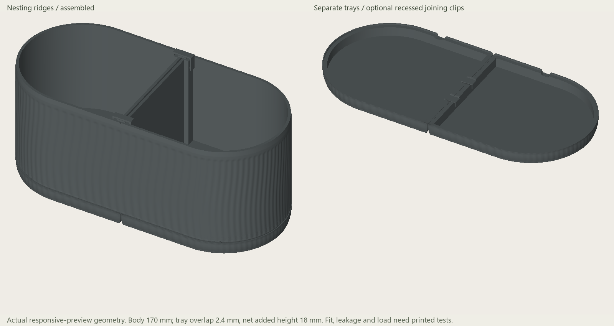
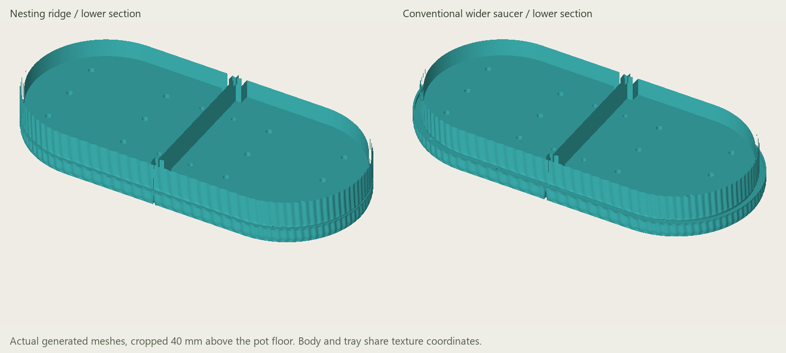
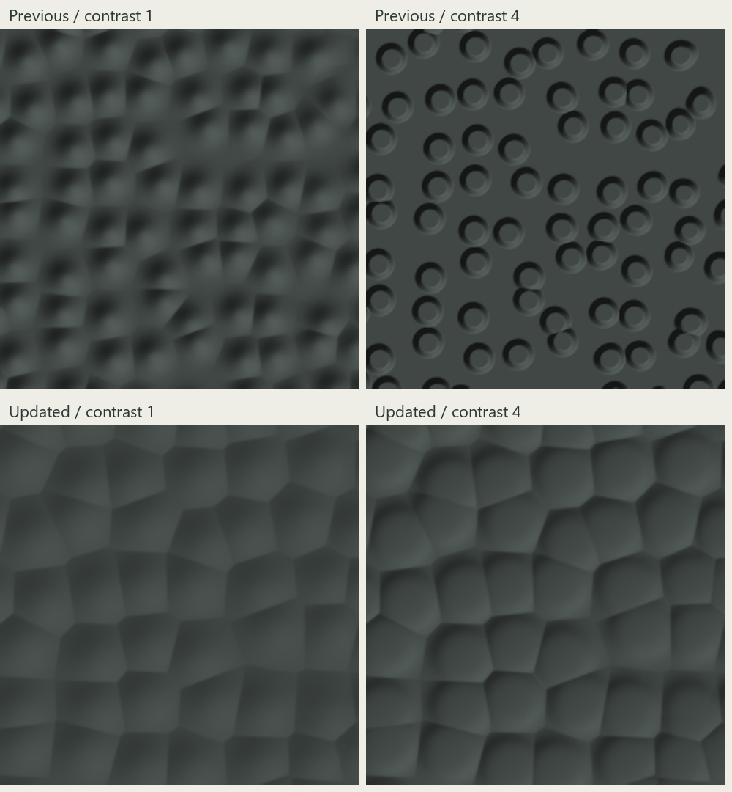
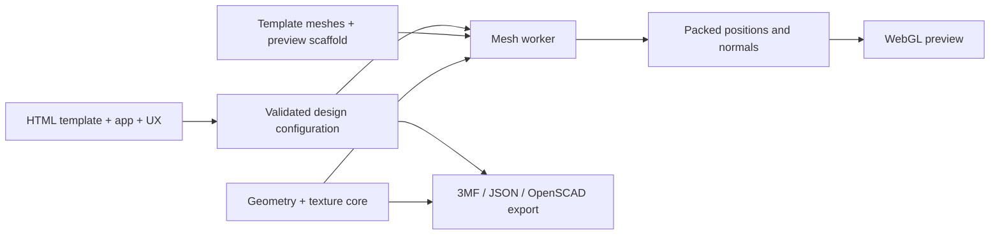

# Vase Builder

**Design textured, modular planters in your browser and export real printable geometry.**

Vase Builder is an offline design tool for configurable planter bodies, connecting
parts, drainage and matching drip trays. Start from a preset, adjust the proportions,
and explore procedural or image-based textures in a rotatable 3D preview. Export
an unsliced, multi-plate 3MF project when you are ready to prepare a print.

The interface retains the earlier **Capsule / Planter Studio** name in places.
The current model system focuses on modular planters rather than arbitrary
lathed vases or guaranteed watertight vessels.

## Features

- Capsule, rounded rectangle, rectangle and faceted footprints, with shape-specific controls.
- Configurable dimensions, wall thickness, rim reinforcement, edge finishes and print-space limits.
- Procedural textures including hammered Mineral cells, waves, honeycomb, stone mosaic and Japandi reeds.
- Raised ribs, curved ribbons and geometric profiles; depth, spacing, twist and rounding controls.
- Image-to-mesh relief from PNG, JPEG and WebP; scale, angle, contrast, inversion and placement.
- Texture presets, reset, texture-only randomization, color preview and a 0.2–30 mm top lip.
- Adjustable round or slotted drains, optional removable grilles and mesh-retaining frames.
- Matching nesting trays or wider conventional saucers, with optional joining clips.
- Assembly, individual-part and fit-test views; illustrated assembly instructions.
- Responsive worker-based preview, three mesh-detail levels, a full-detail inspection mode and bounded recovery.
- Multi-plate 3MF export with process settings, a compact fit-test plate, settings JSON and OpenSCAD geometry snapshots.

## Screenshots and previews

These are software-rendered geometry previews from the project, not browser
screenshots or photographs of physical prints. They illustrate the design and
texture behavior; the interface may differ from earlier previews.



*Matching body and tray design.*



*Tray styles: a matching base or a wider water-catching saucer.*



*Mineral: the lower row shows adjoining curved cells, including at higher contrast.*

## Installation

### Build from source

Requires Python **3.12** with its standard library. The reference toolchain is
Python **3.12.14** and Node.js **24.19.0**; Node is only needed for tests and geometry
scaffold regeneration. No `pip install`, `npm install`, API key or account is needed.

After publication, clone the repository and build:

```sh
git clone https://github.com/rogergmartins/vase-builder.git
cd vase-builder
python scripts/build.py
```

Open `dist/index.html` in a desktop browser with WebGL, Web Workers, Blob URLs,
`DecompressionStream` and `createImageBitmap` support. If your browser restricts
local-file features, serve the built folder:

```sh
python -m http.server 8000 --bind 127.0.0.1 --directory dist
```

Then visit `http://127.0.0.1:8000`. This server is for local development only.
The built HTML is self-contained and does not download scripts, fonts or meshes.

On systems where Python is named `python3`, substitute it in the commands above.
On Windows, `py -3.12` is another option.

## Usage

1. **Choose a starting planter.** Set the printable X, Y and Z space and brim allowance.
2. **Shape the body.** Set width, height, module count, footprint and edge finishes.
3. **Choose a texture.** Use the image cards, then adjust depth, scale, density or profile controls.
   Reset restores that texture's defaults. Randomize changes the surface rather than the structure.
4. **Adjust the top lip.** Use a small height to carry the texture nearly to the rim.
5. **Configure drainage and the base.** Choose holes or slots, covers, a nesting tray or a wider saucer.
6. **Inspect the assembly.** Rotate and zoom; switch parts or use Full detail for a closer check.
7. **Print the fit-test plate first.** Verify the connectors and tray ridge with your material and printer.
8. **Export 3MF.** Open it as a project in your slicer, select the correct printer and filament,
   review every plate and the embedded process values, then slice.

Save settings as JSON to keep an editable design. Imported texture images become
height-map data in those settings; inspect shared settings and exports for private content.
An OpenSCAD download is a selected-geometry snapshot, not the original parametric source.

## Architecture



| Location | Responsibility |
| --- | --- |
| `src/index.template.html` | Layout, styling and controls |
| `src/app.js`, `src/ux.js` | Configuration, interaction, accessible labels/help and preview scheduling |
| `src/core.js` | Shapes, textures, mesh transformation, validation, plate planning and exporters |
| `src/tray.js`, `src/base.js` | Trays, receiving ridges and supporting base geometry |
| `src/preview.js`, `src/mesh-worker.js` | WebGL rendering and background geometry generation |
| `src/assembly.js` | Configuration-aware assembly guide |
| `assets/mesh-data.json` | Original triangulated templates used as geometric input |
| `assets/seam-data.json.gz` | Regenerable, compressed regular-surface preview scaffold |
| `scripts/` | Standard-library build, regeneration and publication hygiene checks |
| `tests/` | Geometry, export, control, rendering and worker regression checks |

The build embeds compressed geometry and JavaScript into one HTML file. Workers
return packed render buffers; preview caches have size limits. Export uses the
selected geometry quality, independently of responsive-preview recovery.

## Development workflow

```sh
python scripts/build.py
python scripts/test.py
python scripts/test.py --extended
```

Run commands from the repository root. The extended suite exercises actual Node
workers, rapid edits and preview recovery, then regenerates the preview scaffold
and compares it with the checked-in asset. Allow several minutes and up to about
4 GB of heap for dense geometry operations.

When changing template geometry or its surface preparation:

```sh
python scripts/regenerate_seams.py
python scripts/build.py
python scripts/test.py --extended
```

Commit the updated source and compressed scaffold together. Generated HTML,
exports and local test files belong in ignored `dist/`. The build removes gzip
timestamps and filenames; repeat builds with the same toolchain are checked for
byte equality. Compression-library changes can change compressed bytes across
environments. See [development notes](docs/DEVELOPMENT.md).

GitHub Actions is configured to build and run the extended suite on pushes and
pull requests. It does not deploy a website or publish releases.

## Limitations

This is an experimental geometric design tool. Closed-mesh checks do not establish
physical watertightness, strength, fit or drainage performance. Test prints and
inspection in your own slicer are necessary. 3MF process metadata targets an
Orca-derived multi-plate layout; other slicers may ignore settings or plate grouping.
Large depth, density or Ultra detail settings can be slow and generate large files.

The automated UI and rendering tests use DOM/WebGL test doubles, with real workers
for background jobs. They do not replace native-browser visual checks. Physical
printing and a browser compatibility matrix have not been certified.

## Contributing

See [CONTRIBUTING.md](CONTRIBUTING.md) for changes and validation expectations.
For security concerns, see [SECURITY.md](SECURITY.md). Please use only texture
images and other assets you have permission to redistribute.

## License

**CC0-1.0**, preserving the project's existing public-domain dedication. See the
full [LICENSE](LICENSE) and [provenance and dependency inventory](NOTICE.md).
The source, original geometry and included geometry previews are covered by that
dedication. External reference photographs, concept artwork and user uploads are
not bundled or covered. Third-party names and linked guidance are not endorsements.
